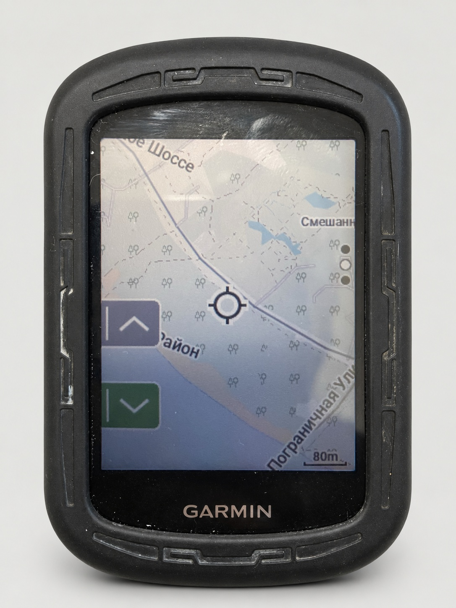
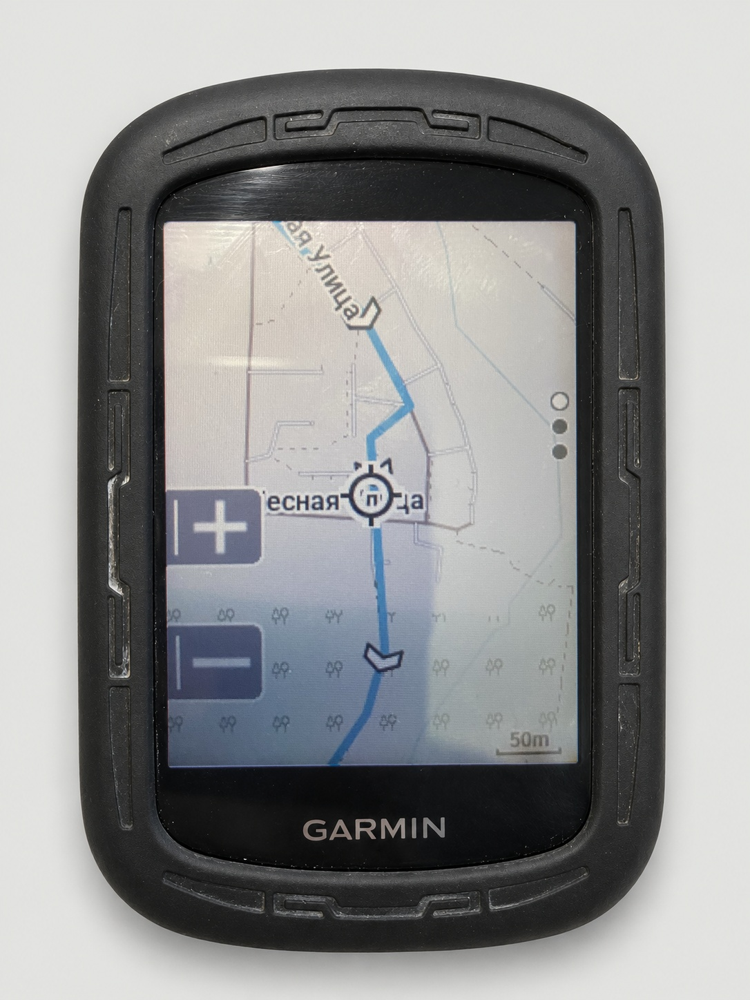

# Gravel Navigation Pro

Простая офлайн-карта Северо-Западного федерального округа для Garmin Edge 540. Сделали её для велопоездок по городу и лесу, чтобы на развилке хватало одного взгляда на экран.

**[Сборка от 22 ноября 2026][current-release]** · 2,24 ГБ в двух томах RAR

| Дороги и тропы · 80 м | Курс на карте · 50 м |
| :---: | :---: |
|  |  |

*На фото выпуск от 8 ноября на Edge 540. Синяя линия — активный курс Garmin. [Превью текущей сборки](docs/images/map-preview.png).*

## Установка

1. Скачайте оба тома, **part1.rar** и **part2.rar**, со [страницы релиза][current-release] в одну папку.
2. Откройте первый том в 7-Zip или WinRAR и извлеките **gravel-szfo.img**.
3. Подключите Edge по USB и скопируйте IMG в папку **Garmin**.
4. В профиле занятий откройте **Навигация → Карта → Информация о карте** и включите **KMap**. [Руководство Edge 540](https://www8.garmin.com/manuals/webhelp/GUID-17DE938E-466A-4746-BDBF-7A6FC1B3A32C/EN-US/GUID-2ADCD0D5-D5CB-4C29-9ACB-EE8BA1FDCC64.html)

При обновлении сохраните предыдущий IMG на компьютере и замените его на Edge.

### Линия активного курса

Если нужна пурпурная линия курса, скачайте **GravelNavigation.kmtf** из файлов релиза и скопируйте его в **Garmin/MapThemes**. В профиле занятий откройте **Навигация → Карта → Вид → Тема карты** и выберите добавленную тему. [Руководство Edge 540](https://www8.garmin.com/manuals/webhelp/GUID-17DE938E-466A-4746-BDBF-7A6FC1B3A32C/EN-US/GUID-64559AAF-F709-414B-BB7C-7BE447CF0D21.html)

## Как читать карту

- **Сплошные линии** — дороги.
- **Коричневый двухцветный штрих** — грунтовки.
- **Тонкие бежевые штрихи** — тропы, **зелёные** — велодорожки.

Лес и вода помогают сориентироваться. Часть значков скрыта, горизонтали отключены. Поиск, маршрутизация и данные высот сохранены.

[Легенда с цветами](docs/images/legend.png) · [Как собрана карта](docs/build.md) · [Публикация](docs/publish.md)

© OpenStreetMap contributors, ODbL. [Данные и атрибуция](docs/build.md#источники)

[current-release]: docs/releases/szfo-2026-11-22.md
