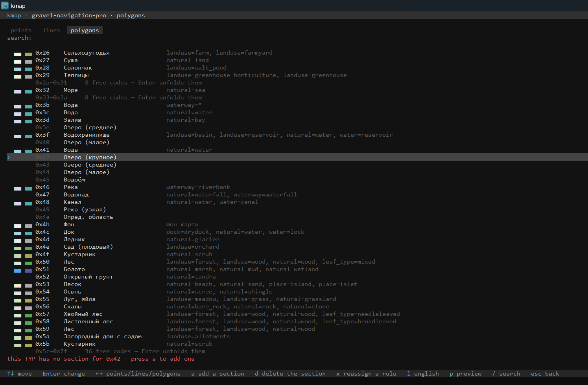
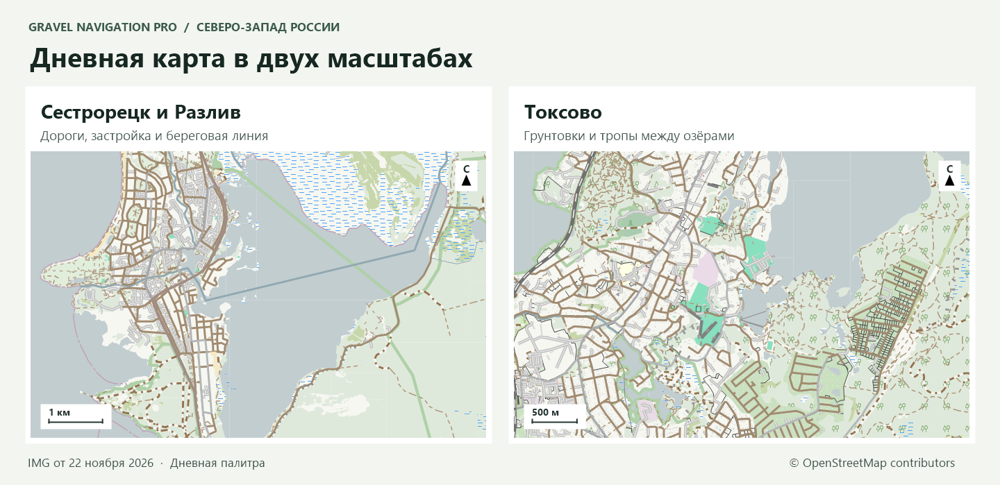

# Как собрана карта

Сборка СЗФО от 22 ноября 2026 года использует KMap 1.9.3 и mkgmap r4924. На устройстве версия семейства отображается как **26.11**. В [параметрах сборки](../profiles/edge-540-gravel.json) сохранены профиль, план масштабов и точный список скрываемых объектов.

## Параметры

| Параметр | Значение |
| --- | --- |
| Регион | northwestern-fed-district, Северо-Западный федеральный округ |
| Стиль | typ:gravel-navigation-pro, дневная тема |
| Профиль и масштаб | Edge 540 Gravel, Smooth и Gravel Minimal |
| Подписи | name:ru → name → int_name → name:en, кодовая страница 1251 |
| Маршрутизация | Включена, с ремонтом коротких разрывов до 5 м |
| Поиск | Индекс включён, номера домов выключены |
| DEM | Copernicus GLO-30, GLO-90 как резерв, коррекция высот вершин |
| Слои | Морская береговая линия включена, горизонтали выключены |
| Точки | Выборочное скрытие POI. Описания OSM и отдельный файл GPI выключены |
| Выход | IMG, автоматическое деление Fit, Family ID 6300 |

В KMap скопировали палитру osm-carto, настроили цвета и штрихи линий, затем выбрали заливки для воды, леса и застройки. Профиль задаёт 152 скрываемых типа, среди них кафе, АЗС и кемпинги.

План **Gravel Minimal** ограничивает видимость деталей. Ноль — ближайший масштаб. Значения ниже задают последний уровень, на котором группа остаётся видимой.

| Группа | Уровни |
| --- | --- |
| Лес | 0–4 |
| Тропы | 0–3 |
| Ограждения, железные дороги и детали рельефа | 0–1 |
| POI, землепользование и военные зоны | 0 |
| Горизонтали | 0 в плане, выключены в сборке |

Разрешения KMap в сборке — **0:24, 1:23, 2:22, 3:21, 4:19, 5:18, 6:17**. Обзор — **7:16, 8:15, 9:14, 10:13**. Конкретный экранный масштаб зависит от устройства и его настроек детализации.

## Линии и цвета

Цвета сверены со встроенным дневным TYP. Коды 0x11F… принадлежат видимым линиям в готовом IMG. KMap использует отдельные коды для внешнего вида ряда маршрутизируемых дорог.

Активный курс рисует тема Edge поверх карты. В [GravelNavigation.kmtf](../styles/GravelNavigation.kmtf) для `MPM_ACTV_CRS_CLR` задан пурпурный цвет `#FFFF00FF` днём и ночью. Параметры толщины `scale="3.00"` и `border="2.00"` перенесены из сохранённой темы. Их эффект на Edge 540 ещё предстоит проверить.

| Что на карте | Код TYP в IMG | Дневной вид |
| --- | --- | --- |
| Автомагистраль | 0x11F01 | Сплошная терракотовая **#D58B71**, 2 px |
| Шоссе | 0x11F02 | Сплошная серо-коричневая **#A18D84**, 2 px |
| Основная дорога | 0x11F03 | Сплошная серая **#858B91**, 2 px |
| Второстепенная дорога | 0x11F04 | Сплошная серая **#A5A9AD**, 2 px |
| Улица класса tertiary | 0x11F05 | Сплошная светло-серая **#B3B6B7**, 2 px |
| Местная дорога, включая жилые улицы | 0x11F06 | Сплошная тёпло-коричневая **#A18B70**, 2 px |
| Подъездная дорога | 0x11F07 | Светлая **#F5F2F5** шириной 1 px с серой окантовкой **#C2C3C1** шириной 1 px с каждой стороны |
| Грунтовая дорога, track / unsurfaced | 0x11F0A | Двухцветный штрих **#92734F / #F7F5F2**, 2 px |
| Путь, path | 0x11F0E | Бежевый штрих **#AA9375**, 1 px |
| Велодорожка, cycleway | 0x11F11 | Приглушённый зелёный штрих **#71958B / #F7F5F2**, 2 px |
| Тропа, footway и близкие типы | 0x11F16 | Светло-коричневый штрих **#B2A18D**, 1 px |
| Железная дорога | 0x14 | Серая линия **#707070** с белыми вставками **#FFFFFF**, 3 px |
| Ручей и река | 0x18, 0x1F | Серо-голубые **#91A8B0**, 1 и 2 px |
| Пересыхающий водоток | 0x26 | Серо-голубой штрих **#91A8B0**, 1 px |
| Ограждение | 0x17 | Тёмно-серая линия **#444444**, 1 px |
| Достроенная перемычка | 0x0D | Красный штрих **#D40000**, 2 px |

Суша кремовая **#F7F7F2**, лес светло-зелёный **#DFE9DB** с текстурой **#93B684** на детальных масштабах. Жилая застройка **#EAE9E5**, здания **#DADAD6**. Море и водоёмы залиты приглушённым серо-голубым **#C2CDD0**.

*Редактор TYP в KMap, 8 ноября 2026 года. Цвета текущей сборки приведены выше.*

## Повторить в KMap

1. Установите [KMap](https://github.com/kmaptool/kmap/releases) и подготовьте зависимости через **Toolchain**. Для этой сборки использовалась версия 1.9.3.
2. Скопируйте [текстовый TYP](../styles/gravel-navigation-pro.txt) в каталог **typ** данных KMap. На Windows путь по умолчанию — **%LOCALAPPDATA%\kmap\typ**. Перезапустите KMap и проверьте идентификатор в выводе команды **kmap styles**.
3. Создайте в KMap профиль **Edge 540 Gravel** и план **Gravel Minimal** по [снимку настроек](../profiles/edge-540-gravel.json). Выберите их на экране сборки. Укажите стиль **gravel-navigation-pro** и регион **Northwestern Federal District**. В JSON есть список скрытых объектов и значения перекрытия тайлов.

Если профиль и план уже заведены, те же параметры можно выбрать из командной строки.

~~~sh
kmap build northwestern-fed-district --profile="Edge 540 Gravel" --style=typ:gravel-navigation-pro --zoom-plan="Gravel Minimal" --format=img --out=./dist
kmap verify путь-к-собранному.img
~~~

KMap обычно скачивает актуальный срез. Для повторения сборки от 22 ноября понадобятся указанный ниже PBF, такой же кеш высот, береговой линии и границ, а также те же версии инструментов.

## Проверка файла

Команда **kmap verify** подтвердила 98 тайлов с маршрутизацией и один обзорный тайл. DEM присутствует во всех 99 тайлах. Индекс MDR/SRT, встроенный TYP семейства 6300 и покрытие тайлов прошли проверку. **kmap typdump** прочитал все 264 определения, включая 58 линий, 70 полигонов и 136 точек.

[Размер и SHA-256 IMG](releases/szfo-2026-11-22.md#проверка-файла)

## Предпросмотр из IMG

*Геометрия и дневная палитра из IMG от 22 ноября 2026 года.*

## Источники

- Данные карты © OpenStreetMap contributors, ODbL. Срез **northwestern-fed-district-261121.osm.pbf** весит **658 561 245 байт**. SHA-256 — **0fa1a98851574f34e100ceaa8631138e5ada3bc4a0e20e5b4a5994e8825af3d4**. [OpenStreetMap](https://www.openstreetmap.org/copyright) · [Geofabrik СЗФО](https://download.geofabrik.de/russia/northwestern-fed-district.html)
- В слой высот вошли 523 ячейки Copernicus DEM GLO-30. KMap уточнил высоты вершин по OSM. GLO-90 был выбран как резерв для ячеек без GLO-30, которые оказались в открытом море. [Атрибуция Copernicus DEM](releases/szfo-2026-11-22.md#источники)
- Стиль сделан на основе палитры osm-carto из KMap. Происхождение базовой палитры и значков описано в документации KMap. [KMap NOTICE](https://github.com/kmaptool/kmap/blob/main/NOTICE.md)
